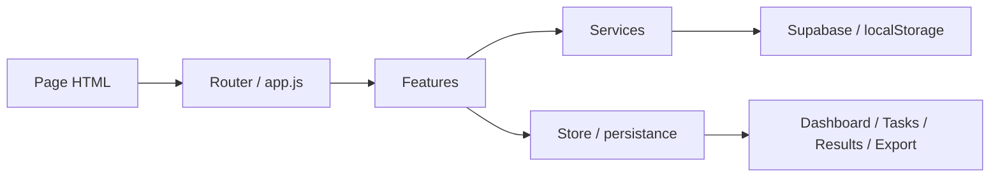
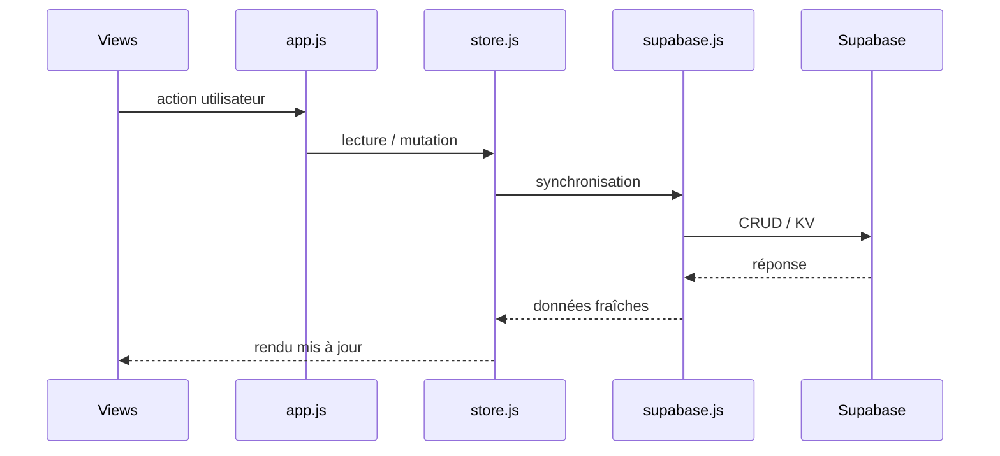

# Architecture et conception

## Structure actuelle et cible

Le dépôt est aujourd'hui majoritairement organisé selon une logique de monolithe front :

- HTML principal dans `index.html`
- CSS dans `src/styles/`
- logique applicative dans `src/app/core/` et `src/app/features/`
- données et services dans `src/app/services/`

La migration cible consiste à poursuivre la séparation par responsabilités et à appliquer un design system raisonnable.



## Diagramme de flux de données



## Architecture i18n

```mermaid
flowchart TD
  A[lang selector / localStorage] --> B[setLang(lang)]
  B --> C[document.documentElement.lang]
  B --> D[document.documentElement.dir]
  B --> E[applyI18n()]
  E --> F[data-i18n nodes]
  F --> G[fr.json / ar.json]
  G --> H[UI text rendered]
```

## Cycle de vie du bilinguisme

1. La langue est lue depuis `localStorage` ou le navigateur.
2. `setLang(lang)` est appelé.
3. `html.lang` et `html.dir` sont mis à jour.
4. Les nœuds DOM portant `data-i18n` reçoivent leur traduction.
5. Les dates, nombres et pourcentages passent par `Intl` selon la locale active.

## Gestion RTL

Le support RTL repose sur :

- `dir="rtl"` sur l'élément racine
- propriétés CSS logiques (`margin-inline-start`, `padding-inline-end`, `inset-inline-*`)
- ajustement des positions des éléments flottants, modales et toasts
- inversion de signes directionnels pour les icônes

Le système est conçu pour rester compatible avec des composants déjà existants tout en gardant une migration progressive.
